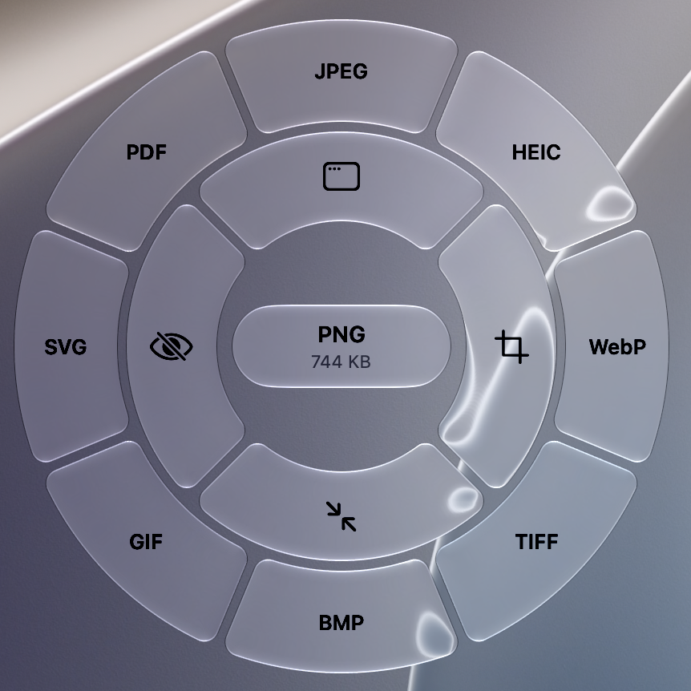
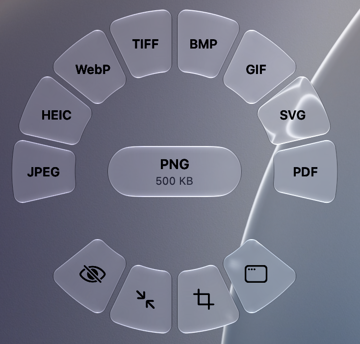
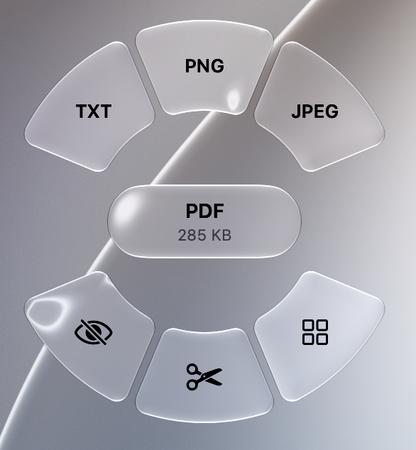
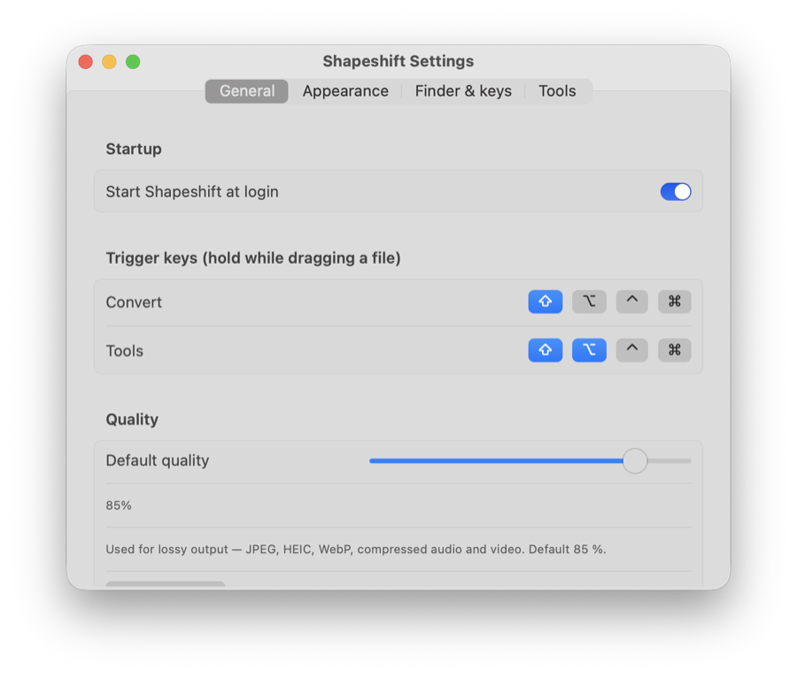
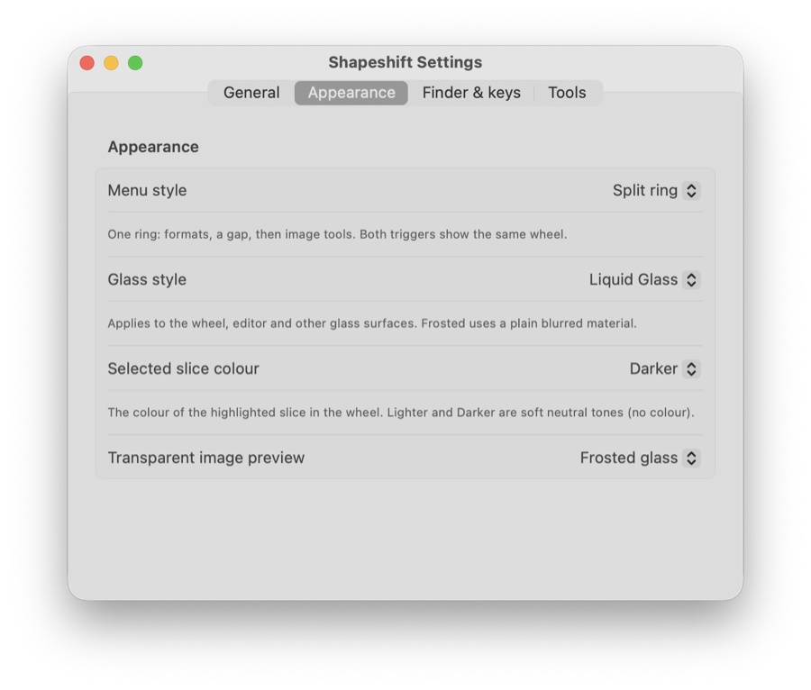

<p align="center">
  
</p>

<h1 align="center">Shapeshift</h1>

<p align="center">
  A macOS menu bar app that converts and edits files locally.<br>
  Hold <b>Shift</b> while dragging a file and drop it on the format you want.
</p>

Shapeshift sits in the menu bar. Drag a file with a modifier key held and a wheel of actions appears around the pointer: drop on a format to convert, or on a tool to edit. The same actions are in Finder's right-click menu. Everything runs on your Mac; nothing is uploaded and the original file is never changed.

<p align="center">
  
  &nbsp;&nbsp;
  
  &nbsp;&nbsp;
  
</p>

## Features

- **Convert** images, audio, video, documents and PDFs. The wheel previews the result in its centre: the new format and an estimated file size.
- **Image tools:** *Frame* (rounded card with border, shadow and an optional macOS window frame), *Crop*, *Compress* to a target size, *Strip metadata*.
- **PDF tools:** *Pages* (reorder, rotate, delete), *Split*, *Merge*, *Redact* (flattens redacted pages so the text underneath is really gone).
- **Finder integration:** right-click files › Shapeshift… (at the bottom of the menu, or under Services).
- **Liquid Glass** design on macOS 26 and later (frosted material on older systems), several menu styles, a selectable highlight colour and start at login.

## Settings

<p align="center">
  
  &nbsp;
  
</p>

## Supported formats

| From | To |
| --- | --- |
| JPG, PNG, HEIC, WebP, TIFF, BMP, GIF, SVG | Any other image format, plus PDF. SVG output embeds the image as a PNG; it is not a vector trace. SVG → WebP is not offered. |
| MP3, M4A, WAV, FLAC, OGG, Opus, AIFF | Any other audio format |
| MP4, MOV, MKV, WebM, AVI | Any other video format, GIF, or audio |
| DOCX, DOC, ODT, RTF, HTML, TXT | PDF |
| PDF | TXT, or PNG / JPG at 200 dpi (a folder with one image per page) |

Audio and video need [ffmpeg](https://ffmpeg.org) (`brew install ffmpeg`); everything else works without it. Documents are laid out by the macOS text engine, so complex Word layouts (headers, columns, floating images) can differ from Word. A `.gdoc` file is only a link to an online document: download it from Google Docs as DOCX first. PDFs are not OCR'd and password-protected PDFs are not supported.

## Download and install

**You only need the disk image. You do not need the source code or Xcode.**

1. Download **`Shapeshift.dmg`** from the [Releases](../../releases) page (under *Assets* of the latest release).
2. Open it and drag **Shapeshift** onto the **Applications** shortcut.
3. Start Shapeshift from Applications. The app is signed ad hoc (not notarized), so the first launch needs right-click › **Open**.

Requires macOS 13 or later on an Apple Silicon Mac. Audio and video conversion also needs ffmpeg (`brew install ffmpeg`); see [Supported formats](#supported-formats).

The rest of this page (building from source, project layout) is only for people who want to develop Shapeshift.

## Usage

| Action | How |
| --- | --- |
| Convert | Hold **Shift**, drag files, drop on a format |
| Edit | Hold **Shift+Option**, drag files, drop on a tool |
| From Finder | Right-click files › **Shapeshift…**, then click or use the arrow keys and Return |

The trigger keys, menu style (two rings, split ring, two steps or classic grid), glass style, highlight colour and start at login are in **Settings** (menu bar icon › Settings…). Showing the menu while you drag needs the Input Monitoring permission, which Settings helps you grant.

## Build from source (for developers)

Requires macOS 13 or later (the macOS 26 SDK to build the Liquid Glass code), Apple Silicon, and Xcode with the Swift 6 toolchain.

```sh
swift test                     # run the test suites
scripts/build-app.sh           # build build/Shapeshift.app
scripts/make-dmg.sh            # build build/Shapeshift.dmg
```

If the project lives in an iCloud-synced folder, codesign can fail; build outside it:

```sh
SCRATCH_PATH=/tmp/shapeshift-build scripts/build-app.sh
```

After changing the app icon in Icon Composer run `scripts/make-icns.sh` and commit `Resources/AppIcon.icns`; after changing the S shape also run `scripts/make-menubar-icon.sh`.

## Project layout

See [docs/ARCHITECTURE.md](docs/ARCHITECTURE.md) for how the pieces fit together, [docs/design](docs/design) for the design records, and [docs/manual-test-checklist.md](docs/manual-test-checklist.md) for the hands-on checks that automated tests cannot cover.

## Acknowledgements

Shapeshift is heavily inspired by **[Tangerine](https://tangerineformac.com/)** by Leap Studio, a Mac app that converts files by dragging them onto a menu next to the pointer. The core idea (hold a key while dragging a file and drop it on a ring of target formats), the pie-wheel menu with a slice per action and a preview of the result in the centre, and much of the overall layout and interaction take their cue from Tangerine; thank you for a great concept.

Shapeshift is an independent implementation with its own code, design and extra tools (Frame, PDF tools, SVG, Finder integration, several menu styles), and is not affiliated with or endorsed by Leap Studio. If you want the original, polished and supported app, get Tangerine.

## License

[MIT](LICENSE) © 2026 Jacob Berggren
